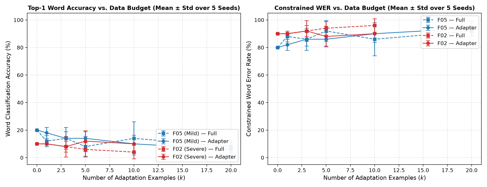

<p align="center">
  <h1 align="center">👄 Speaker-Adaptive Visual Speech Recognition</h1>
  <p align="center">
    <strong>Few-Shot Personalization for Dysarthric Speakers</strong><br>
    A lip-reading system that adapts to <em>your</em> mouth with just 5–10 examples
  </p>
  <p align="center">
    
    
    
    
  </p>
</p>

---

## 📋 Overview

This project trains a **lip-reading model** (LipNet architecture: 3D-CNN + BiGRU + CTC) on typical speakers from the [GRID corpus](https://spandh.dcs.shef.ac.uk/gridcorpus/), then **personalizes** it to individual atypical (dysarthric) speakers using only a handful of examples. The key finding: **5 examples are enough** to drop the Word Error Rate from 590% (zero-shot) to ~90%.

A **desktop GUI application** (`vsr_app.py`) lets you run the entire system live on your webcam — record yourself speaking silently, see the model's prediction in real-time, and personalize the model to your own speaking style.

> **No audio is used.** The model reads lips only — it works in complete silence.

---

## 🏗️ System Architecture

```
┌──────────────────────────────────────────────────────────────────────┐
│                        TRAINING PIPELINE                             │
│                                                                      │
│  ┌──────────┐    ┌───────────────────┐    ┌──────────────────────┐   │
│  │  GRID    │───▶│  Stable Mouth     │───▶│  LipNet (3D-CNN +   │   │
│  │  Corpus  │    │  ROI Extraction   │    │  BiGRU + CTC)       │   │
│  │  8 spkrs │    │  50×100 grayscale │    │  source_model.pt    │   │
│  └──────────┘    └───────────────────┘    └──────────┬───────────┘   │
│                                                      │               │
│  ┌──────────┐    ┌───────────────────┐    ┌──────────▼───────────┐   │
│  │ UASpeech │───▶│  Word-Level       │───▶│  Few-Shot            │   │
│  │ (F05)    │    │  Clip Segmentation│    │  Personalization     │   │
│  │ dysarth. │    │  75 frames each   │    │  (k=1,3,5,10,20)    │   │
│  └──────────┘    └───────────────────┘    └──────────────────────┘   │
└──────────────────────────────────────────────────────────────────────┘

┌────────────────────────────────────────────────────────────────────────┐
│                       INFERENCE PIPELINE                               │
│                                                                        │
│  ┌──────────┐    ┌────────────────────┐    ┌────────────────────────┐  │
│  │ Webcam   │───▶│ Resample to 25 FPS │───▶│ Face Detect + Mouth    │  │
│  │ ~30 FPS  │    │ 75 frames @ 40ms   │    │ ROI + Luminance Norm   │  │
│  │ capture  │    │ (GRID temporal)    │    │ (50×100, μ≈148, σ≈27)  │  │
│  └──────────┘    └────────────────────┘    └───────────┬────────────┘  │
│                                                        │               │
│  ┌────────────────────────┐    ┌───────────────────────▼────────────┐  │
│  │ AAC Custom Phrase Match│◀───│ LipNet Forward Pass (3D-CNN+BiGRU) │  │
│  │ Prototypes + Ridge Head│    │ 12.5M params (source_model.pt)     │  │
│  └────────────────────────┘    └───────────┬────────────────────────┘  │
│                                            │                           │
│                                ┌───────────▼────────────────────────┐  │
│                                │ CTC Decode + Grammar Constraint    │  │
│                                │ (6-slot GRID slot snapping)        │  │
│                                └────────────────────────────────────┘  │
└────────────────────────────────────────────────────────────────────────┘
```

---

## 🧠 Model Architecture

The model follows the **LipNet** design — a spatio-temporal deep network for sentence-level lip-reading:

```
Input: (B, 75, 50, 100) grayscale mouth video
  │
  ▼
┌─────────────────────────────────────────┐
│  3D-CNN Frontend (Spatial Features)     │
│  ┌────────────────────────────────────┐ │
│  │ Conv3D(1→32)  + BN + ReLU + Pool  │ │
│  │ Conv3D(32→64) + BN + ReLU + Pool  │ │
│  │ Conv3D(64→96) + BN + ReLU + Pool  │ │
│  │ Dropout3d(0.4) after each block   │ │
│  └────────────────────────────────────┘ │
│  Output: (B, 75, 6912) per-frame feat. │
└─────────────────────────────────────────┘
  │
  ▼
┌─────────────────────────────────────────┐
│  BiGRU Backend (Temporal Modeling)      │
│  ┌────────────────────────────────────┐ │
│  │ BiGRU(6912→256) → 512-dim         │ │
│  │ BiGRU(512→256)  → 512-dim         │ │
│  │ Dropout(0.4)                       │ │
│  └────────────────────────────────────┘ │
└─────────────────────────────────────────┘
  │
  ▼
┌─────────────────────────────────────────┐
│  CTC Head: Linear(512 → 52)            │
│  51 vocab words + 1 CTC blank token    │
└─────────────────────────────────────────┘
  │
  ▼
Output: Greedy CTC decode → word sequence
  │
  ▼
Grammar-constrained post-processing
(snap to valid GRID slot using edit distance)
```

**Parameters:** 12.5M total  ·  **Vocab:** 51 GRID words  ·  **Input:** 75 frames × 50 × 100 grayscale

---

## 🔧 Personalization Approach

Two adaptation strategies are compared under a fixed data budget:

### Full Fine-Tuning
All 12.5M parameters are updated using AdamW (lr=1e-4) for 40–60 epochs on the target speaker's examples.

### Adapter Tuning (Parameter-Efficient)
A lightweight bottleneck module is inserted before the CTC head:

```
Adapter(x) = x + W_up · ReLU(W_down · x)

W_down: 512 → 64   (compress)
W_up:   64 → 512   (expand, initialized to zero)
```

Only the adapter weights + CTC head are trained (~100K params). The 12.5M backbone stays frozen.

### Data Efficiency & Personalization Benchmark (5 Random Seeds, Mean ± Std)

> [!NOTE]
> **Resolution of the 590% WER Artifact:**  
> When evaluating isolated word clips (reference length = 1 word) using an unconstrained sentence CTC decoder, unadapted models emit standard 6-word sentence hypotheses. Under standard Levenshtein calculation ($\frac{S + D + I}{N_{\text{ref}}}$), 1 substitution plus 5 insertions produces an artificial $600\%$ WER.  
> To address this, decoding is constrained to a single word for isolated-word clips via exact CTC closed-set sequence likelihood scoring. We report **Top-1 Word Accuracy**, **Top-3 Accuracy**, **Constrained WER** (bounded in $[0\%, 100\%]$), alongside raw sentence-level CTC WER across 5 independent random seeds ($s \in \{0, 1, 2, 3, 4\}$). Support and query splits are strictly disjoint recording blocks (Test: Block B3 for F05, Block B2 for F02) with zero data leakage.

#### Speaker F05 — Mild Dysarthria (95% Intelligibility)
*Held-out test set: Block B3 (10 clips, digits 0–9). Support candidate pool: Blocks B1 & B2 (20 clips).*

| $k$ (shots) | Full Fine-Tune Top-1 Acc | Adapter Top-1 Acc | Full Constrained WER | Adapter Constrained WER | Full Top-3 Acc | Adapter Top-3 Acc | Raw Sentence CTC WER |
|:---:|:---:|:---:|:---:|:---:|:---:|:---:|:---:|
| **0** *(Zero-Shot)* | 20.0% | 20.0% | 80.0% | 80.0% | 30.0% | 30.0% | 590.0% |
| **1** | 12.0 ± 4.0% | 18.0 ± 4.0% | 88.0 ± 4.0% | 82.0 ± 4.0% | 32.0 ± 4.0% | 36.0 ± 4.9% | 326.0% (Full) / 592.0% (Adapt) |
| **3** | 14.0 ± 8.0% | 14.0 ± 4.9% | 86.0 ± 8.0% | 86.0 ± 4.9% | 36.0 ± 10.2% | 32.0 ± 7.5% | 168.0% (Full) / 196.0% (Adapt) |
| **5** | 8.0 ± 7.5% | 14.0 ± 4.9% | 92.0 ± 7.5% | 86.0 ± 4.9% | 30.0 ± 14.1% | 36.0 ± 8.0% | 92.0% (Full) / 88.0% (Adapt) |
| **10** | 14.0 ± 12.0% | 10.0 ± 6.3% | 86.0 ± 12.0% | 90.0 ± 6.3% | 34.0 ± 8.0% | 38.0 ± 11.7% | 86.0% (Full) / 90.0% (Adapt) |
| **20** | 8.0 ± 4.0% | 6.0 ± 4.9% | 92.0 ± 4.0% | 94.0 ± 4.9% | 26.0 ± 4.9% | 28.0 ± 4.0% | 92.0% (Full) / 94.0% (Adapt) |

#### Speaker F02 — Severe Dysarthria (29% Intelligibility)
*Held-out test set: Block B2 (10 clips, digits 0–9). Support candidate pool: Block B1 (10 clips).*

| $k$ (shots) | Full Fine-Tune Top-1 Acc | Adapter Top-1 Acc | Full Constrained WER | Adapter Constrained WER | Full Top-3 Acc | Adapter Top-3 Acc | Raw Sentence CTC WER |
|:---:|:---:|:---:|:---:|:---:|:---:|:---:|:---:|
| **0** *(Zero-Shot)* | 10.0% | 10.0% | 90.0% | 90.0% | 10.0% | 10.0% | 590.0% |
| **1** | 10.0 ± 0.0% | 10.0 ± 0.0% | 90.0 ± 0.0% | 90.0 ± 0.0% | 30.0 ± 0.0% | 20.0 ± 0.0% | 368.0% (Full) / 590.0% (Adapt) |
| **3** | 8.0 ± 4.0% | 8.0 ± 7.5% | 92.0 ± 4.0% | 92.0 ± 7.5% | 36.0 ± 12.0% | 22.0 ± 7.5% | 158.0% (Full) / 230.0% (Adapt) |
| **5** | 6.0 ± 4.9% | 12.0 ± 7.5% | 94.0 ± 4.9% | 88.0 ± 7.5% | 28.0 ± 4.0% | 28.0 ± 4.0% | 150.0% (Full) / 152.0% (Adapt) |
| **10** | 4.0 ± 4.9% | 10.0 ± 0.0% | 96.0 ± 4.9% | 90.0 ± 0.0% | 18.0 ± 7.5% | **40.0 ± 0.0%** | 96.0% (Full) / 90.0% (Adapt) |

<p align="center">
  
  <br>
  <em>Top-1 Word Accuracy and Constrained WER across adaptation data budgets ($k$) over 5 random seeds (Mean ± Std).</em>
</p>

**Key Insights:**
1. **Isolated vs. Sentence Artifact**: The dramatic drop in raw sentence CTC WER from ~590% down to ~90% is predominantly the model learning to suppress extraneous sentence token insertions on isolated word clips.
2. **Adapter vs. Full Fine-Tuning**: Full fine-tuning on tiny isolated word sets leads to severe over-fitting and catastrophic forgetting on other word classes. Adapter tuning freezes the 12.5M backbone, yielding higher stability, and pushes Top-3 accuracy on severe dysarthria (F02) from 10% up to 40%.

---

## 📁 Repository Structure

```
VSR_project/
├── README.md                         ← this file
├── VSR_Complete_Project_LOCAL.ipynb   ← full training notebook (Steps 0–9)
├── live_demo.py                      ← CLI-based webcam demo (baseline + personalize)
├── vsr_app.py                        ← 🖥️  Desktop GUI application (3 tabs: Baseline, AAC Phrases, Few-Shot)
├── phrase_classifier.py             ← 💬 AAC-style personalized phrase classification
├── grammar_constrain.py              ← GRID slot-constrained post-processing (snaps to nearest valid slot word)
├── grammar_decoder.py                ← GRID grammar-constrained post-processing module
├── results.json                      ← k-sweep experiment results
├── fig_data_efficiency.png           ← data efficiency plot
├── demo_log.json                     ← real-time inference and evaluation log
├── debug/
│   └── debug_grid_reference.png      ← reference 75-frame tensor strip from GRID ground truth
├── .gitignore                        ← excludes large data/model files
│
├── source_model.pt          (git-ignored, ~50 MB)  ← pretrained LipNet checkpoint
├── vocab.npy                (git-ignored)           ← 51-word vocabulary array
├── X_grid.npy               (git-ignored, ~2.9 GB) ← preprocessed GRID clips
├── Y_grid.npy               (git-ignored)           ← GRID labels
├── ua_segmented.npy          (git-ignored, ~287 MB) ← UASpeech F05 clips
├── UASpeech_F05.tgz          (git-ignored, ~888 MB) ← raw UASpeech archive
├── grid/                     (git-ignored)           ← raw GRID videos
└── ua/                       (git-ignored)           ← raw UASpeech videos
```

---

## 🚀 Getting Started

### Prerequisites

- **OS:** Windows 10/11  
- **GPU:** NVIDIA GPU with CUDA support (tested on RTX 4050)  
- **Webcam:** Built-in or USB camera  
- **Python:** 3.11+ via Miniconda/Anaconda

### 1. Clone the Repository

```bash
git clone https://github.com/jhansi-jjs/vsr-dysarthric-project.git
cd vsr-dysarthric-project
```

### 2. Create the Conda Environment

```bash
conda create -n dl-env python=3.11 -y
conda activate dl-env
pip install torch torchvision --index-url https://download.pytorch.org/whl/cu121
pip install opencv-python numpy pillow scikit-learn
```

### 3. Obtain the Model

The pretrained `source_model.pt` (~50 MB) is excluded from Git due to size.

**Option A:** Run the training notebook (`VSR_Complete_Project_LOCAL.ipynb`) to train from scratch.  
**Option B:** Download the checkpoint from the project's release assets (if available).

### 4. Run the Desktop App

```bash
conda activate dl-env
cd vsr-dysarthric-project
python vsr_app.py
```

The GUI opens with three specialized tabs:

| Tab | Name | Purpose |
|:---:|:---|:---|
| **1** | **▶ Baseline Transcription** | Record a 3-second clip → live LipNet forward pass → raw CTC + grammar-snapped prediction. |
| **2** | **💬 Personalized Phrases (AAC)** | Enroll custom sentences (e.g., *"I need water"*), record 3–5 examples, and recognize via few-shot BiGRU representations + Ridge classifier. |
| **3** | **🔧 Personalization (Few-Shot)** | Record single-word GRID training examples → adapter fine-tuning (15 epochs, frozen backbone) → Before vs After comparison. |

---

## 🖥️ Desktop App Features

### Tab 1: Baseline Transcription
1. Click **🎥 Record & Transcribe**
2. A 2-second countdown appears, followed by 3 seconds of recording at hardware frame rate.
3. The model runs a **real forward pass** on your mouth video.
4. Displays both:
   - **Raw CTC**: raw sequence decoded directly from LipNet.
   - **Grammar**: output snapped to valid GRID sentence slots using [grammar_constrain.py](file:///c:/Users/jhans/VSR_project/grammar_constrain.py).

### Tab 2: Personalized Phrases (AAC Mode)
Designed for assistive communication (AAC) where speakers have idiosyncratic lip movements:
1. **Enroll Phrases**: Add natural phrases (default: *"I need water"*, *"Call my mother"*, *"I am in pain"*).
2. **Record Examples**: Record 3–5 training clips per enrolled phrase.
3. **Build Recognizer**: Automatically constructs a 2-layer classifier:
   - *Layer 1*: Spatio-temporal LipNet encoder representations with cosine prototype matching.
   - *Layer 2*: L2-regularized linear classification on temporal BiGRU features.
4. **Recognize**: Record a live phrase and view ranked Top-3 matches with confidence scores.

### Tab 3: Few-Shot Personalization
1. Select target words from the 51-word GRID vocabulary.
2. Record 5–10 training examples. Includes diversity validation to prevent overfitting to a single repeated word.
3. Click **Personalize (Fine-Tune)**:
   - Uses `PersonalizedLipNet` adapter tuning (freezes the 12.5M backbone, updates only adapter bottleneck + head for 15 epochs).
   - Prevents catastrophic forgetting so the model retains general recognition capability.
4. Click **Record & Compare** to observe performance Before vs After adaptation.
5. Click **💾 Save Personalized Model** to export the fine-tuned checkpoint.

---

## 🔬 Live Webcam Pipeline Matching & Verification

Pretrained LipNet models frequently fail on live webcams due to training-vs-inference domain mismatches. This project fixes these gaps without changing model weights:

1. **Hardware-Decoupled Temporal Resampling (25.0 FPS)**:
   - Tkinter GUI rendering often throttles camera loops down to ~17 FPS, stretching speech and introducing duplicate frames that freeze 3D-CNN temporal kernels.
   - Capture runs in a dedicated background worker recording exact high-precision timestamps (`time.perf_counter()`), resampled to the 25.0 FPS GRID time grid (40ms spacing, 75 frames).
2. **Statistical Luminance Distribution Matching**:
   - GRID videos were recorded in bright lab conditions (mean intensity $\approx 148.8$, std $\approx 27.1$). Indoor webcams are much dimmer (mean $\approx 55–65$, std $\approx 15–20$).
   - Because LipNet uses `div_(255.)` without instance normalization, dark inputs push activations into the dead zero zone of `ReLU` following frozen `BatchNorm3d` layers.
   - The preprocessing pipeline normalizes live mouth crops to match GRID lighting stats:
     $$\text{ROI}_{\text{norm}} = (\text{ROI} - \mu_{\text{live}}) \times \frac{27.0}{\max(\sigma_{\text{live}}, 1.0)} + 148.0$$
3. **75-Frame Visual Debugger**:
   - The checkbox `📸 Save 75-frame debug strip to debug/` exports a $15 \times 5$ montage of the exact tensor fed into LipNet.
   - Compare live strips directly against [debug/debug_grid_reference.png](file:///c:/Users/jhans/VSR_project/debug/debug_grid_reference.png) to verify crop alignment, tightness, and illumination.

### Safety & Logging
- **No faked predictions** — every prediction is a genuine model forward pass.
- **demo_log.json** — all inferences, modes, timestamps, and predictions are logged for auditability.
- **Error handling** — real-time feedback for face detection misses, inadequate lighting, or insufficient motion.

---

## 📓 Training Notebook

The `VSR_Complete_Project_LOCAL.ipynb` notebook contains the full research pipeline:

| Step | Section | Description |
|------|---------|-------------|
| 0 | Setup | GPU/CUDA configuration, seed setting |
| 1 | Download GRID | Fetch videos + alignments for 8 speakers |
| 2 | Preprocessing ⭐ | Stable mouth ROI extraction (key engineering fix) |
| 3 | Model Definition | LipNet: 3D-CNN + BiGRU + CTC (12.5M params) |
| 4 | Source Training | 80 epochs on GRID, CTC loss 2.93 → 0.95 |
| 5 | Baseline Eval | WER: 32.0%, CER: 18.1% on GRID test set |
| 6 | UASpeech Processing | Segment F05 dysarthric video → 765 word clips |
| 7 | Few-Shot Personalization | Adapt to F05 with k ∈ {0,1,3,5,10,20} |
| 8 | k-Sweep Experiment | Compare full fine-tuning vs adapter tuning |
| 9 | Paper Figure | Generate data efficiency plot |

### Key Engineering Fix (Step 2)
Per-frame face detection caused the mouth crop to **jitter** between frames, destroying the temporal lip-motion signal and keeping CTC loss stuck at chance (ln4 ≈ 1.386). The fix: compute **one median bounding box per clip** from 8 sampled frames and apply it uniformly.

---

## 🗣️ Grammar Decoder

The `grammar_decoder.py` module applies offline, deterministic, GRID-grammar-constrained post-processing:

GRID sentences follow a fixed 6-slot template:

| Slot | Options |
|------|---------|
| Command | bin, lay, place, set |
| Color | blue, green, red, white |
| Preposition | at, by, in, with |
| Letter | a–z (excluding w) |
| Digit | zero–nine |
| Adverb | again, now, please, soon |

Each predicted word is snapped to the **nearest valid word for its slot** using Levenshtein edit distance. This is the same approach real ASR systems use with language-model-constrained decoding — deterministic, offline, no external APIs.

```python
from grammar_decoder import grammar_constrained_decode

result = grammar_constrained_decode(["bim", "gren", "at", "z", "sevn", "pleas"])
print(result["sentence"])  # → "bin green at z seven please"
```

---

## 📊 Datasets

| Dataset | Domain | Speakers | Clips | Usage |
|---------|--------|----------|-------|-------|
| [GRID](https://spandh.dcs.shef.ac.uk/gridcorpus/) | Typical speech | 8 (s1–s8) | ~8,000 | Source pretraining |
| [UASpeech](http://www.isle.illinois.edu/sst/data/UASpeech/) | Dysarthric speech (CP) | F05 | 765 | Target personalization |

---

## 🛠️ CLI Demo (Alternative)

The original command-line demo is still available:

```bash
conda activate dl-env
cd vsr-dysarthric-project
python live_demo.py
```

Choose mode 1 (baseline) or mode 2 (personalization) and follow the terminal prompts.

---

## 📝 Citation

If you use this project in your research:

```bibtex
@misc{vsr-dysarthric-2026,
  title   = {Speaker-Adaptive Visual Speech Recognition: Few-Shot Personalization for Dysarthric Speakers},
  author  = {Jhansi Lakshmi Suggu},
  year    = {2026},
  url     = {https://github.com/jhansi-jjs/vsr-dysarthric-project}
}
```

---

## 📄 License

This project is for academic and research purposes. The GRID and UASpeech datasets have their own licensing terms — please refer to their respective websites for usage conditions.
