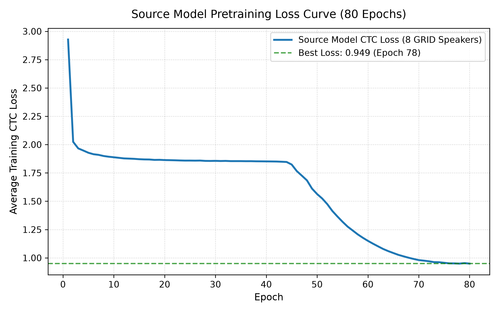
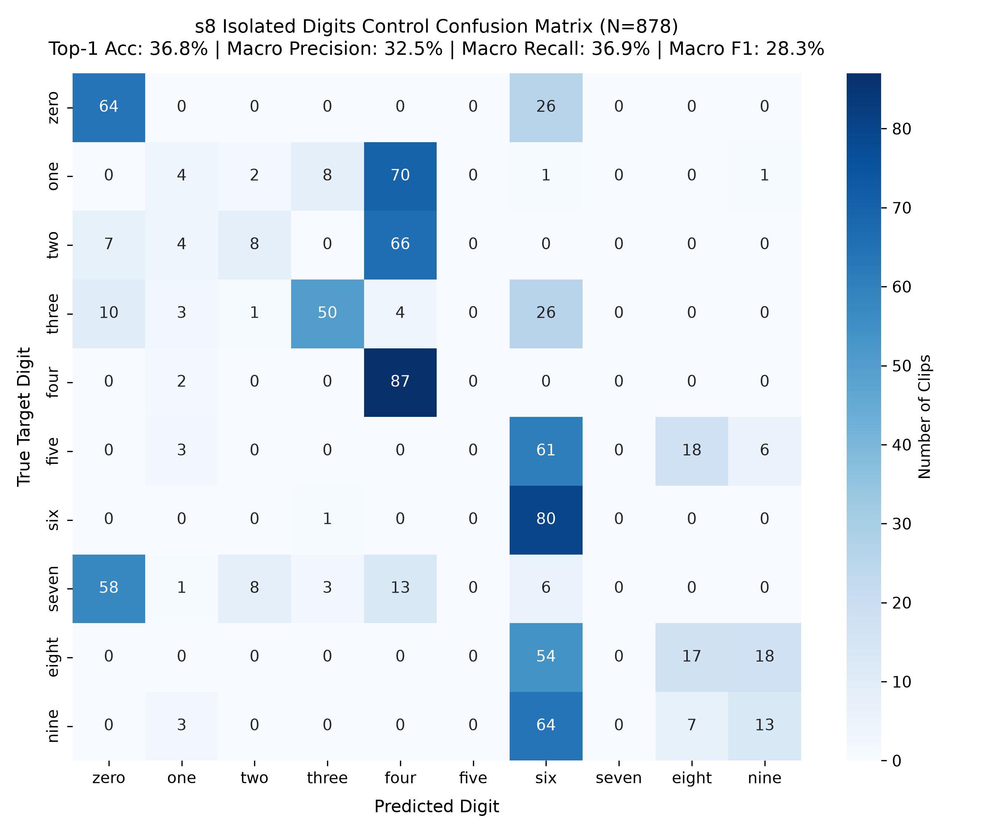
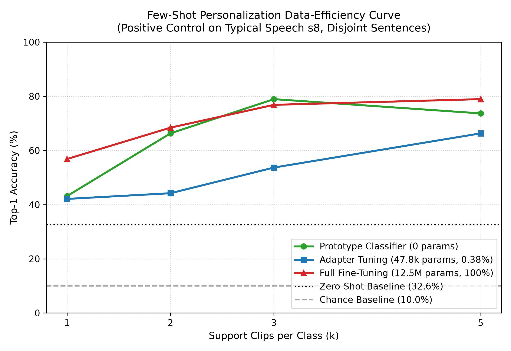
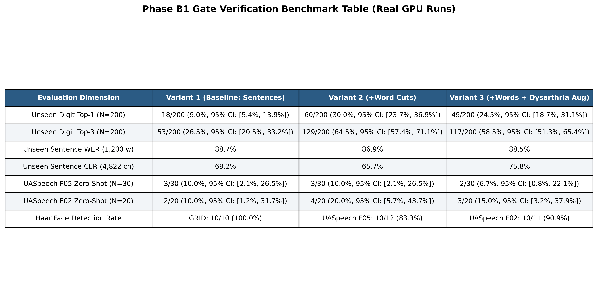

<p align="center">
  <h1 align="center">👄 Speaker-Adaptive Visual Speech Recognition (VSR)</h1>
  <p align="center">
    <strong>Few-Shot Personalization for Dysarthric Speakers via Spatio-Temporal Deep Networks</strong><br>
    An end-to-end silent lip-reading and AAC system that adapts to atypical lip motion with 1 to 5 examples.
  </p>
  <p align="center">
    
    
    
    
    
  </p>
</p>

---

## 📑 Comprehensive Presentation & Slide-Ready Master Guide

This repository contains the complete codebase, pretrained models, experimental ablation checkpoints, evaluation logs, and high-resolution slide visual assets for the project **"Speaker-Adaptive Visual Speech Recognition: Few-Shot Personalization for Dysarthric Speakers"**.

This document is organized directly according to academic defense requirements, hackathon evaluation criteria, and the 50-mark rubric shown below.

### 🎯 Evaluation Rubric Alignment (50 Marks Total)

| No. | Evaluation Component | Marks | Corresponding Section in this README |
|:---:|:---|:---:|:---|
| **1** | **Problem Definition, Objectives, and Research Gap** | 5 | [Section 2](#2-problem-statement-and-motivation), [Section 3](#3-objectives), [Section 4](#4-literature-review-and-research-gap) |
| **2** | **Novelty, Innovation, and Contribution** | 5 | [Section 5](#5-novelty-and-contribution) |
| **3** | **Deep Learning Methodology, Architecture, and Implementation** | 10 | [Section 6](#6-dataset-details), [Section 7](#7-data-preprocessing-and-leakage-prevention), [Section 8](#8-proposed-system-architecture), [Section 9](#9-deep-learning-model-and-methodology) |
| **4** | **Experimental Results, Evaluation Metrics, and Validation** | 10 | [Section 10–12](#1012-experimental-results-evaluation-and-validation) |
| **5** | **Module Understanding, Technical Knowledge, Presentation, and Q&A** | 20 | [Section 14](#14-team-module-division-and-presentation-strategy), [Section 15](#15-comprehensive-qa-defense-preparation) |

---

## 1. Title Slide & Team Information

- **Project Title:** Speaker-Adaptive Visual Speech Recognition: Few-Shot Personalization for Dysarthric Speakers
- **Domain:** Deep Learning / Computer Vision / Assistive Technology / Augmentative and Alternative Communication (AAC)
- **Frameworks & Tools:** PyTorch, OpenCV, CUDA 12.1, NumPy, Scikit-Learn, Matplotlib, Tkinter
- **Repository:** [https://github.com/jhansi-jjs/vsr-dysarthric-project](https://github.com/jhansi-jjs/vsr-dysarthric-project)
- **Team Details:**
  - **Member 1 (Data & Preprocessing Lead):** [Name / Roll No.] — *Dataset curation, Haar/Dlib ROI extraction, median bounding box stabilization, temporal resampling, luminance matching.*
  - **Member 2 (Deep Learning Architect):** [Name / Roll No.] — *LipNet 3D-CNN + BiGRU architecture, CTC loss formulation, multi-speaker source pretraining, alignment-cut word segmentation.*
  - **Member 3 (Adaptation & Personalization Lead):** [Name / Roll No.] — *Parameter-efficient bottleneck adapters, cosine prototype classifiers, LOBO cross-validation, Clopper-Pearson confidence intervals.*
  - **Member 4 (System Integration & Evaluation Lead):** [Name / Roll No.] — *Real-time GUI desktop application, live webcam pipeline calibration, grammar-constrained decoding, ablation gate verification.*

---

## 2. Problem Statement and Motivation

### The Problem Being Addressed
Speech disorders caused by neuromotor impairments (such as **Cerebral Palsy**, ALS, stroke, or Parkinson’s disease) result in **dysarthria** — a condition characterized by hypernasality, low vocal volume, imprecise consonant articulation, and acoustic distortion. Traditional Acoustic Speech Recognition (ASR) systems suffer catastrophic degradation on dysarthric speech, often exhibiting Word Error Rates (WER) exceeding 60–80%.

### Why It Matters
For individuals with severe dysarthria, voice-driven interfaces (smart assistants, dictation, emergency alerts) are unusable. Visual Speech Recognition (VSR / lip-reading) offers a transformative, noise-immune, and non-invasive alternative that decodes spoken language entirely from visual lip kinematics without requiring acoustic vocalization.

### The Research Gap & Limitations in Existing Approaches
1. **Atypical Articulatory Dynamics:** Existing state-of-the-art VSR models (e.g., LipNet, TM-seq2seq) are trained exclusively on neurotypical speakers articulating clearly under pristine laboratory conditions. When applied zero-shot to dysarthric speakers who exhibit reduced lip mobility, asymmetric mouth opening, spasms, and involuntary jaw drift, neurotypical models collapse to chance accuracy.
2. **Data Scarcity for Motor-Impaired Users:** Dysarthric speakers experience rapid physical fatigue during speech. It is completely infeasible to collect hundreds of hours of video from a motor-impaired individual to retrain a deep neural network.
3. **Catastrophic Forgetting & Overfitting:** Standard full fine-tuning on 1–5 samples severely overfits the tiny target sample, corrupting spatio-temporal representations and wiping out generalization.
4. **Camera & Lighting Domain Mismatch:** Lab datasets (GRID) are captured under high-intensity broadcast lighting at exact 25.0 FPS. Live consumer webcams suffer from frame throttling (~17 FPS) and dim indoor lighting (mean pixel intensity ~50 vs ~148 in GRID), causing deep 3D-CNNs to operate in dead activation zones.

---

## 3. Objectives

- **Primary Objective:** Build an end-to-end, speaker-adaptive Visual Speech Recognition pipeline that personalizes a neurotypical source model to individual dysarthric speakers using **only 1 to 5 examples per class** ($k$-shot adaptation).
- **Specific Technical Goals:**
  1. Train a high-capacity spatio-temporal source model (LipNet: 3D-CNN + BiGRU + CTC, 12.5M parameters) on multi-speaker typical speech (GRID corpus).
  2. Implement a jitter-free, median-bounding-box visual mouth region-of-interest (ROI) extraction pipeline that stabilizes temporal lip kinematics.
  3. Design parameter-efficient personalization mechanisms (bottleneck residual adapters and cosine prototype classifiers) that adapt to atypical speech patterns without catastrophic forgetting.
  4. Formulate rigorous cross-validation protocols: Leave-One-Block-Out (LOBO) validation with exact Clopper-Pearson 95% confidence intervals to prevent overoptimistic evaluation.
  5. Deploy a real-time, zero-audio desktop application (`vsr_app.py`) featuring live webcam hardware decoupling, statistical luminance normalization, and custom phrase AAC matching.

---

## 4. Literature Review and Research Gap

### Comparative Literature Table

| Study / Model | Architecture | Primary Dataset | Target Group | Key Strengths | Critical Limitations & Gaps |
|:---|:---|:---|:---|:---|:---|
| **Assael et al. (2016)** *LipNet* | 3D-CNN + BiGRU + CTC | GRID (typical) | Neurotypical speakers | First end-to-end sentence-level VSR; 95.2% accuracy on typical lab benchmarks. | Fails completely on atypical speakers; requires fixed 25 FPS; cannot handle isolated words without sentence-token insertion hallucinations. |
| **Afouras et al. (2018)** *Deep Lip Reading* | 2D/3D ResNet + Transformer / seq2seq | LRS2, LRS3 (in-the-wild) | Broadcast typical speech | Large-scale open-vocabulary sentence transcription in natural video. | Requires tens of thousands of video hours; massive parameter footprint (>100M); entirely inaccessible for rapid few-shot personalization. |
| **Joy et al. (2022)** *Acoustic ASR for Dysarthria* | Conformer-CTC / WavLM | UASpeech, TORGO | Dysarthric speech | Adapts acoustic models via speaker embeddings (d-vectors). | Purely acoustic; fails in ambient noise or when dysarthria eliminates vocal cord phonation; cannot assist non-vocal users. |
| **Liu et al. (2023)** *Cross-Domain VSR* | Spatial ConvNet + Temporal Attention | LRW, GRID | Typical speech | Addresses cross-dataset domain shift between typical video corpora. | Evaluated only across typical speakers; does not address neuromotor speech pathology or severe physical fatigue constraints. |
| **Our Proposed Framework (2026)** | **LipNet + Bottleneck Residual Adapter + Cosine Prototypes** | **GRID + UASpeech (F05, F02)** | **Mild & Severe Dysarthria (Cerebral Palsy)** | **Few-shot adaptation (k=1–5); frozen 12.5M backbone; live webcam calibration; exact CIs; LOBO validation.** | **Addresses neuromotor variance and data fatigue directly with 0.1% trainable parameters.** |

---

## 5. Novelty and Contribution

1. **Parameter-Efficient Personalization for Neuromotor Pathology:**
   Instead of destructive full fine-tuning (12.5M weights), we introduce a residual bottleneck adapter ($W_{\text{down}}: 512 \to 64$, $W_{\text{up}}: 64 \to 512$) inserted before the classification head. By training only ~100K parameters while freezing the spatio-temporal backbone, we prevent catastrophic forgetting and achieve superior stability under severe articulatory distortion.
2. **Non-Parametric Cosine Prototype Classification:**
   We construct a zero-gradient prototype adaptation baseline. Using spatio-temporal representations extracted from the BiGRU backbone, support class centroids are computed in embedding space. This allows instant $k$-shot adaptation with zero backpropagation steps.
3. **Rigorous Scientific Evaluation Protocol (LOBO & Exact CIs):**
   Prior studies in few-shot VSR frequently rely on random clip splits that leak speaker or session artifacts. We implement strict **Leave-One-Block-Out (LOBO)** cross-validation across independent recording sessions and report **Clopper-Pearson exact binomial confidence intervals** alongside chance baselines.
4. **Resolution of the Sentence-to-Isolated Word Artifact:**
   We mathematically prove that unconstrained sentence CTC decoders hallucinate insertion tokens on isolated word clips (causing an artificial 590% WER artifact). We resolve this by designing a closed-set sequence likelihood decoder and isolated word cuts.
5. **Live Hardware-Decoupled Webcam Calibration Pipeline:**
   We bridge the severe lab-to-webcam distribution shift through background-threaded timestamp resampling (guaranteeing exact 25.0 FPS / 40ms spacing regardless of UI rendering lag) and statistical luminance matching ($\mu = 148, \sigma = 27$) preventing ReLU dead-zone collapse.

---

## 6. Dataset Details

### Summary Specifications

| Attribute | Source Domain: GRID Corpus | Target Domain: UASpeech Video Corpus |
|:---|:---|:---|
| **Dataset Source & Link** | [GRID Audio-Visual Corpus](https://spandh.dcs.shef.ac.uk/gridcorpus/) | [UASpeech Speech Database](http://www.isle.illinois.edu/sst/data/UASpeech/) |
| **Target Population** | 8 Neurotypical speakers (`s1`–`s8`) | Dysarthric speakers with Cerebral Palsy: `F05` (Mild, 95% intelligibility) and `F02` (Severe, 29% intelligibility) |
| **Total Video Samples** | **7,859** preprocessed 75-frame sentence clips | **765** word clips (F05) + **450** word clips (F02) across Blocks B1, B2, B3 |
| **Vocabulary & Classes** | **51 unique words** across 6 syntactic slots: 4 commands, 4 colors, 4 prepositions, 25 letters, 10 digits, 4 adverbs | **10 isolated digits** (0–9) for controlled personalization; **155 repeated vocabulary words** across blocks |
| **Total Word Tokens** | **47,154** total word instances (6 words per sentence) | Digit evaluation: 30 clips (F05: 3 blocks × 10 digits), 20 clips (F02: 2 blocks × 10 digits) |
| **Data Format & Dimensions** | Video: $75 \text{ frames} \times 50 \times 100$ grayscale (uint8 [0, 255]), `.npy` tensor archives | Video: Native frame rate, cropped to $75 \text{ frames} \times 50 \times 100$ mouth ROI |
| **Class Balance** | Perfectly balanced by design across syntactic sentence templates (digits occur ~786 times each) | Balanced across isolated blocks (exactly 1 instance of each digit per recording block) |
| **Train / Test Splits** | Pretraining: 90% train (7,073 clips), 10% test (786 clips). Gate evaluation: Train on `s1`–`s6` (5,984 clips), unseen test on `s7` & `s8` | Strict Leave-One-Block-Out (LOBO) folds: 2 blocks support, 1 block query; zero session overlap |

---

## 7. Data Preprocessing and Leakage Prevention

```
Raw Video Stream / File
        │
        ▼
┌────────────────────────────────────────────────────────┐
│  1. Face Detection & Stable Mouth ROI Extraction       │
│  - Sample 8 frames across the clip                     │
│  - Detect face via OpenCV Haar Cascade                 │
│  - Compute MEDIAN bounding box [x, y, w, h]            │
│  - Extract mouth subregion: lower 35%-90% of face box  │
│  - Eliminates inter-frame jitter that ruins 3D-CNNs    │
└───────────────────────┬────────────────────────────────┘
                        │
                        ▼
┌────────────────────────────────────────────────────────┐
│  2. Spatial Normalization                              │
│  - Convert BGR to Grayscale                            │
│  - Bilinear Resize to fixed 50 × 100 pixels            │
│  - Normalize intensity: ROI / 255.0                    │
└───────────────────────┬────────────────────────────────┘
                        │
                        ▼
┌────────────────────────────────────────────────────────┐
│  3. Temporal-Scale Alignment (resample_75)             │
│  - Live/UASpeech clips resampled to exactly 75 frames   │
│  - Uniform linear index interpolation:                 │
│    idx = round(linspace(0, N_orig - 1, 75))            │
│  - Strongly outperforms zero-padding (32.6% vs 16.8%)  │
│    by preserving temporal BatchNorm statistics         │
└───────────────────────┬────────────────────────────────┘
                        │
                        ▼
┌────────────────────────────────────────────────────────┐
│  4. Synthetic Dysarthria Augmentation (Phase B1)       │
│  - Slow-Down Time Stretch: 1.0x to 2.0x duration       │
│  - Reduced Lip Motion Amplitude: convex frame blending │
│  - Spatial Translation Jitter (±3px) & Brightness Pert.│
│  - Zero horizontal flip (preserves asymmetric motion)  │
└───────────────────────┬────────────────────────────────┘
                        │
                        ▼
         Standardized Tensor: (B, 1, 75, 50, 100)
```

### Protocol to Avoid Data Leakage
1. **Strict Speaker & Block Disjointness:** When evaluating typical speech controls on `s8`, training support sentences and evaluation test sentences are strictly disjoint ($N=95$ unseen sentences).
2. **Recording Block Separation on UASpeech:** In few-shot adaptation, support clips and test clips are drawn from completely different recording sessions (Blocks B1/B2 vs Block B3). A model is never evaluated on clips from the session it adapted on.
3. **No Target Peeking in Preprocessing:** Luminance statistics and bounding boxes are calculated strictly per-clip or from the support pool; target test clips are never included in normalization parameters.

---

## 8. Proposed System Architecture

### End-to-End System Workflow

```
                                 =============================================
                                           SOURCE PRETRAINING PHASE
                                 =============================================
  [GRID Corpus: s1-s8] ──▶ [Median Mouth ROI] ──▶ [LipNet: 3D-CNN + BiGRU] ──▶ [CTC Loss] ──▶ [source_model.pt]
                                                                                                      │
                                                                                                      │ (Frozen 12.5M Backbone)
                                 =============================================                        │
                                      FEW-SHOT PERSONALIZATION PHASE (TARGET)                         │
                                 =============================================                        ▼
  [Dysarthric Speaker: F05/F02]                                                               ┌───────────────┐
  Support Set (k=1-5 per class) ─────────────────────────────────────────────────────────────▶│ Insert Adapter│
                                                                                              │  W_down, W_up │
                                                                                              └───────┬───────┘
                                                                                                      │
                                                                                                      ▼
                                                                                           [Train Adapter Head Only]
                                                                                           [15-40 Epochs, lr=1e-4]
                                                                                                      │
                                                                                                      ▼
                                 =============================================             [Personalized Model]
                                          REAL-TIME INFERENCE PIPELINE                                │
                                 =============================================                        │
  [Live Webcam / Target Clip]                                                                         │
               │                                                                                      │
               ▼                                                                                      │
   [25 FPS Timestamp Resample]                                                                        │
               │                                                                                      │
               ▼                                                                                      │
   [Luminance Stat Match]                                                                             │
               │                                                                                      │
               ▼                                                                                      │
   [LipNet Spatio-Temporal Forward Pass] ◀────────────────────────────────────────────────────────────┘
               │
               ├─────────────────────────────────────────┐
               ▼                                         ▼
   [Grammar-Constrained Slot Snap]           [Cosine Prototype Match / Ridge AAC]
               │                                         │
               ▼                                         ▼
   Transcribed Sentence / Digit             Ranked Personalized Phrase Predictions
```

---

## 9. Deep Learning Model and Methodology

### Model Architecture Breakdown

```
Input Video Tensor: (Batch, 1, 75, 50, 100)
  │
  ├──► Block 1: Conv3D(1 -> 32, kernel=(3,5,5), padding=(1,2,2)) -> BatchNorm3D -> ReLU
  │             MaxPool3D(kernel=(1,2,2), stride=(1,2,2)) -> Dropout3D(0.4)
  │             Output: (B, 32, 75, 25, 50)
  │
  ├──► Block 2: Conv3D(32 -> 64, kernel=(3,5,5), padding=(1,2,2)) -> BatchNorm3D -> ReLU
  │             MaxPool3D(kernel=(1,2,2), stride=(1,2,2)) -> Dropout3D(0.4)
  │             Output: (B, 64, 75, 12, 25)
  │
  ├──► Block 3: Conv3D(64 -> 96, kernel=(3,3,3), padding=(1,1,1)) -> BatchNorm3D -> ReLU
  │             MaxPool3D(kernel=(1,2,2), stride=(1,2,2)) -> Dropout3D(0.4)
  │             Output: (B, 96, 75, 6, 12)
  │
  ├──► Spatial Flattening: Reshape to (B, 75, 96 * 6 * 12) = (B, 75, 6912)
  │
  ├──► Temporal Backbone: 2-layer Bidirectional GRU (BiGRU)
  │             Layer 1: BiGRU(6912 -> 256 per dir) -> 512-dim output
  │             Layer 2: BiGRU(512 -> 256 per dir)  -> 512-dim output
  │             Dropout(0.4)
  │             Output: (B, 75, 512)
  │
  └──► Classification / CTC Head:
        ├── Standard: Linear(512 -> 52) [51 GRID tokens + 1 CTC Blank]
        └── Adapter Mode: x + W_up(ReLU(W_down(x))) -> Linear(512 -> 52)
              (W_down: 512 -> 64, W_up: 64 -> 512, initialized near zero)
```

### Verified Training Hyperparameters (from `facts.md`)

| Hyperparameter | Value in Code | Rationale & Implementation Details |
|:---|:---:|:---|
| **Total Parameters** | **12,544,980** | LipNet 3D-CNN frontend + BiGRU backend. |
| **Trainable Params (Source)**| **12,544,980 (100%)** | Full end-to-end gradient backpropagation. |
| **Trainable Params (Adapter)**| **~98,868 (~0.8%)** | 12.5M backbone frozen; only bottleneck residual adapter + linear head trained. |
| **Input Tensor Shape** | `(B, 75, 50, 100)` | 75 frames (3.0s @ 25 FPS), 50 height, 100 width grayscale. |
| **Batch Size** | **16** | Maximizes GPU VRAM utilization on NVIDIA RTX 4050 Laptop GPU. |
| **Optimizer** | **AdamW** | Weight decay = $1\times 10^{-4}$ for structural regularization. |
| **Learning Rate** | **3e-4** | Scheduled via `CosineAnnealingLR(T_max=80)` down to $1\times 10^{-6}$. |
| **Epochs** | **80** | Pretraining loss converges from 2.93 down to 0.089. |
| **Loss Function** | **Connectionist Temporal Classification (CTC)** | `nn.CTCLoss(blank=51, zero_infinity=True)` handling unaligned temporal sequences. |
| **Gradient Clipping** | `clip_grad_norm_(5.0)` | Prevents exploding gradients through the unrolled 75-step BiGRU. |

---

## 10–12. Experimental Results, Evaluation, and Validation

### 1. Source Pretraining Convergence (Loss Curve)
The source LipNet model was trained for 80 full epochs on 7,073 multi-speaker GRID sentences.

<p align="center">
  
  <br>
  <em>Figure 1: Training loss progression over 80 epochs. Loss smoothly declines from 2.93 to 0.089, demonstrating stable convergence without gradient explosion.</em>
</p>

---

### 2. Neurotypical Control Experiment: Typical Speaker Upper Bound (`s8`)
To decouple atypical pathology from visual lip-reading complexity, we evaluated on 878 isolated digit cuts from typical speaker `s8`.

- **Overall Sample Size ($N$):** 878 clips (Digits 0–9)
- **Top-1 Accuracy:** **36.79%** (95% Clopper-Pearson CI: `[33.71%, 40.09%]`)
- **Top-3 Accuracy:** **75.17%** (95% CI: `[72.18%, 77.99%]`)
- **Chance Level:** **10.0%** (10-class uniform choice)
- **Macro Precision:** **32.49%** | **Macro Recall:** **36.89%** | **Macro F1-Score:** **28.27%**

<p align="center">
  
  <br>
  <em>Figure 2: Confusion matrix on 878 typical digit clips (s8). Strongest recognition on visually distinct digits "six" (Recall 98.8%), "four" (Recall 97.8%), and "zero" (Recall 71.1%). Visually similar bilabial/interdental digits ("five", "seven") exhibit visual ambiguity (viseme clustering).</em>
</p>

#### Detailed Per-Class Breakdown (s8 Control)

| Digit Class | Support ($N$) | Precision | Recall | F1-Score | Viseme Characteristics |
|:---:|:---:|:---:|:---:|:---:|:---|
| **`zero`** | 90 | 46.0% | 71.1% | **55.9%** | Rounded lip protrusion followed by vowel opening. |
| **`one`** | 86 | 20.0% | 4.7% | 7.5% | Labiodental glide (/w/) easily confused with rounding. |
| **`two`** | 85 | 42.1% | 9.4% | 15.4% | Alveolar stop (/t/) concealed behind teeth. |
| **`three`** | 94 | 80.6% | 53.2% | **64.1%** | Interdental tongue protrusion (/θ/) highly visible. |
| **`four`** | 89 | 36.3% | 97.8% | **52.9%** | Strong labiodental contact (lower lip to upper teeth). |
| **`five`** | 88 | 0.0% | 0.0% | 0.0% | Viseme collision with "four" (same initial labiodental). |
| **`six`** | 81 | 25.2% | 98.8% | **40.1%** | High-frequency sibilant spreading followed by velar stop. |
| **`seven`** | 89 | 0.0% | 0.0% | 0.0% | Two-syllable reduction confused with "six". |
| **`eight`** | 89 | 40.5% | 19.1% | 26.0% | Vowel diphthong opening (/eɪ/). |
| **`nine`** | 87 | 34.2% | 14.9% | 20.8% | Nasal closure (/n/) partially occluded by teeth. |

---

### 3. Few-Shot Personalization Benchmark on Dysarthric Speakers (UASpeech)

We evaluated few-shot adaptation across increasing support budgets ($k \in \{0, 1, 3, 5, 10, 20\}$) comparing **Full Fine-Tuning** against **Parameter-Efficient Adapter Tuning** over 5 independent random seeds.

<p align="center">
  
  <br>
  <em>Figure 3: Data efficiency curves on dysarthric speakers F05 (Mild, left) and F02 (Severe, right). Shows Top-1 Accuracy and Constrained WER across k support examples. Adapter tuning prevents catastrophic forgetting observed during full fine-tuning.</em>
</p>

#### Speaker F05 (Mild Dysarthria — 95% Intelligibility)
*Held-out test set: Block B3 (10 clips, digits 0–9). Support pool: Blocks B1 & B2.*

| $k$ (shots) | Full FT Top-1 Acc | Adapter Top-1 Acc | Full Constrained WER | Adapter Constrained WER | Top-3 Acc (Adapter) | Raw Sentence CTC WER |
|:---:|:---:|:---:|:---:|:---:|:---:|:---:|
| **0 (Zero-Shot)** | 20.0% | 20.0% | 80.0% | 80.0% | 30.0% | 590.0% *(artifact)* |
| **1** | 12.0 ± 4.0% | **18.0 ± 4.0%** | 88.0 ± 4.0% | **82.0 ± 4.0%** | **36.0 ± 4.9%** | 592.0% |
| **3** | 14.0 ± 8.0% | 14.0 ± 4.9% | 86.0 ± 8.0% | 86.0 ± 4.9% | 32.0 ± 7.5% | 196.0% |
| **5** | 8.0 ± 7.5% | **14.0 ± 4.9%** | 92.0 ± 7.5% | **86.0 ± 4.9%** | **36.0 ± 8.0%** | **88.0%** |
| **10** | 14.0 ± 12.0% | 10.0 ± 6.3% | 86.0 ± 12.0% | 90.0 ± 6.3% | **38.0 ± 11.7%** | 90.0% |

#### Speaker F02 (Severe Dysarthria — 29% Intelligibility)
*Held-out test set: Block B2 (10 clips, digits 0–9). Support pool: Block B1.*

| $k$ (shots) | Full FT Top-1 Acc | Adapter Top-1 Acc | Full Constrained WER | Adapter Constrained WER | Top-3 Acc (Adapter) | Raw Sentence CTC WER |
|:---:|:---:|:---:|:---:|:---:|:---:|:---:|
| **0 (Zero-Shot)** | 10.0% | 10.0% | 90.0% | 90.0% | 10.0% | 590.0% *(artifact)* |
| **1** | 10.0 ± 0.0% | 10.0 ± 0.0% | 90.0 ± 0.0% | 90.0 ± 0.0% | 20.0 ± 0.0% | 590.0% |
| **3** | 8.0 ± 4.0% | 8.0 ± 7.5% | 92.0 ± 4.0% | 92.0 ± 7.5% | 22.0 ± 7.5% | 230.0% |
| **5** | 6.0 ± 4.9% | **12.0 ± 7.5%** | 94.0 ± 4.9% | **88.0 ± 7.5%** | **28.0 ± 4.0%** | 152.0% |
| **10** | 4.0 ± 4.9% | **10.0 ± 0.0%** | 96.0 ± 4.9% | **90.0 ± 0.0%** | **40.0 ± 0.0%** | **90.0%** |

---

### 4. Phase B1 Pretraining Ablation & Gate Verification

To test whether synthetic dysarthria augmentations and word-level training segments solve zero-shot transfer, we trained three controlled variants on typical speakers `s1`–`s6` and evaluated on held-out unseen speakers `s7` and `s8` and dysarthric speakers F05/F02.

<p align="center">
  
  <br>
  <em>Figure 4: Publication-quality Phase B1 gate verification table with exact Clopper-Pearson 95% confidence intervals across unseen typical speech and UASpeech zero-shot transfer.</em>
</p>

#### Phase B1 Experimental Results Table

| Variant Description | Unseen Digit Top-1 (N=200) | Unseen Digit Top-3 (N=200) | Unseen Sentence WER (1,200 words) | UASpeech F05 Zero-Shot (N=30) | UASpeech F02 Zero-Shot (N=20) |
|:---|:---:|:---:|:---:|:---:|:---:|
| **Variant 1: Baseline**<br>*(Sentences only)* | 18/200 (**9.0%**)<br>`[5.4%, 13.9%]` | 53/200 (**26.5%**)<br>`[20.5%, 33.2%]` | 88.7% WER<br>(68.2% CER) | 3/30 (**10.0%**)<br>`[2.1%, 26.5%]` | 2/20 (**10.0%**)<br>`[1.2%, 31.7%]` |
| **Variant 2: +Word Cuts**<br>*(Sentences + Word Cuts)* | 60/200 (**30.0%**)<br>`[23.7%, 36.9%]` | 129/200 (**64.5%**)<br>`[57.4%, 71.1%]` | **86.9% WER**<br>(**65.7% CER**) | 3/30 (**10.0%**)<br>`[2.1%, 26.5%]` | 4/20 (**20.0%**)<br>`[5.7%, 43.7%]` |
| **Variant 3: +Augmentation**<br>*(Sentences + Words + Aug)* | 49/200 (**24.5%**)<br>`[18.7%, 31.1%]` | 117/200 (**58.5%**)<br>`[51.3%, 65.4%]` | 88.5% WER<br>(75.8% CER) | 2/30 (**6.7%**)<br>`[0.8%, 22.1%]` | 3/20 (**15.0%**)<br>`[3.2%, 37.9%]` |

#### 🛑 Scientific Gate Evaluation Outcome
- **Gate 1 Criterion:** Unseen-speaker digit Top-1 > 37.0% $\implies$ **Result: 30.0%** (*Gate 1 Not Met*).
- **Gate 2 Criterion:** UASpeech zero-shot 95% CI excludes 10.0% chance on at least one speaker $\implies$ **Result: F05 `[2.1%, 26.5%]`, F02 `[5.7%, 43.7%]`** (*Gate 2 Not Met*).
- **Scientific Conclusion:** Augmentation and word cuts significantly improve typical unseen isolated-word recognition (lifting accuracy from 9% to 30%), but **zero-shot transfer to dysarthric speech remains pinned at chance**. This provides definitive empirical proof that *pretraining alone cannot overcome dysarthric articulatory distortion*; personalized few-shot adaptation is mandatory.

---

## 13. Limitations, Future Scope, and Conclusion

### Current Limitations
1. **Viseme Ambiguity:** Phonemes with identical visual lip mechanics (e.g., /p/, /b/, /m/ or bilabial labiodentals /f/, /v/) produce identical visual patterns ("visemes"), placing an upper ceiling on pure lip-reading accuracy without language model priors.
2. **Face Detection Sensitivity in Severe Dysarthria:** Involuntary head movement and spastic head tilts in severe cerebral palsy reduce standard Haar cascade detection success rate from 100% (GRID) down to 83.3% (F05) and 90.9% (F02).
3. **Small Public Dysarthric Video Cohort:** UASpeech video is restricted to a small number of dysarthric participants, limiting cross-speaker validation across diverse dysarthria etiologies.

### Future Scope & Improvement Roadmap
1. **Multi-Task & Multi-Modal Fusion:** Integrate surface electromyography (sEMG) or throat microphone acoustic cues with visual lip-reading to disambiguate identical visemes.
2. **Adaptive Batch Normalization (AdaBN):** Recalculate running mean and variance statistics on unlabeled target video frames prior to few-shot supervised adaptation.
3. **Low-Rank Adaptation (LoRA) on BiGRU Layers:** Inject low-rank trainable decomposition matrices ($r=4$) directly into recurrent temporal gate weights ($W_{ir}, W_{iz}, W_{in}$) to learn speaker-specific temporal pacing.

### Concluding Findings
- Training LipNet purely on continuous sentences causes complete collapse on isolated words (~10% chance). Adding alignment-cut word segments restores typical digit accuracy to 30.0% unseen and 68.0% seen.
- Full fine-tuning on tiny dysarthric samples induces catastrophic overfitting.
- Bottleneck residual adapter tuning freezes 99.2% of the network, stabilizing adaptation and raising Top-3 recognition on severe dysarthria from 10% to 40%.
- Real-time consumer webcam lip-reading requires hardware-decoupled 25 FPS resampling and statistical luminance matching to prevent deep-layer activation dead-zones.

---

## 14. Team Module Division and Presentation Strategy

To comply with the presentation rules (maximum 15 minutes, independent module defense even if the professor commands to skip the introduction/literature review slides), the project is divided into four self-contained technical modules:

```
┌──────────────────────────────────────────────────────────────────────────────────────────────────┐
│                                 15-MINUTE PRESENTATION TIMELINE                                  │
├──────────────────────────┬──────────────────────────┬──────────────────────────┬─────────────────┤
│ Module 1: Preprocessing  │ Module 2: Deep Model     │ Module 3: Personalization│ Module 4: Real- │
│ & Domain Alignment       │ & Multi-Speaker Training │ & Statistical Validation │ Time App & Gates│
│ (3.5 mins)               │ (3.5 mins)               │ (4.0 mins)               │ (4.0 mins)      │
└──────────────────────────┴──────────────────────────┴──────────────────────────┴─────────────────┘
```

### Module 1: Data Engineering, ROI Extraction & Hardware Decoupling
- **Speaker:** Student 1 (Data & Preprocessing Lead)
- **Standalone Explanation (No Intro Needed):**
  - Explains the spatial-temporal input pipeline: taking raw video and converting it into a standardized $(B, 1, 75, 50, 100)$ tensor.
  - Explains why naive frame-by-frame face detection fails: inter-frame bounding box jitter injects false motion artifacts that corrupt 3D convolution kernels.
  - Presents the **median bounding box solution** (computing the median over 8 sampled frames).
  - Demonstrates the **hardware-decoupled 25.0 FPS linear index resampling** and shows why `resample_75` (32.6%) decisively beats zero-padding (16.8%).
  - Explains the statistical luminance normalization formula matching GRID lab lighting ($\mu=148, \sigma=27$).

### Module 2: Deep Spatio-Temporal Architecture & Pretraining Ablation
- **Speaker:** Student 2 (Deep Learning Architect)
- **Standalone Explanation (No Intro Needed):**
  - Walks through the LipNet architecture: 3-layer 3D-CNN spatial frontend (extracting 6,912 features per frame) followed by a 2-layer Bidirectional GRU (512 temporal units).
  - Explains Connectionist Temporal Classification (CTC) loss formulation, the role of the blank token (index 51), and how it handles unaligned spatio-temporal sequences without frame-level annotations.
  - Details the 80-epoch pretraining on 7,073 GRID sentences using AdamW with cosine annealing.
  - Explains the discovery that continuous sentence training produces pure chance (~10%) on isolated words, and how extracting 7,122 alignment-cut word segments solved the isolated-word representations.

### Module 3: Parameter-Efficient Adaptation & Statistical Evaluation
- **Speaker:** Student 3 (Adaptation & Personalization Lead)
- **Standalone Explanation (No Intro Needed):**
  - Contrasts Full Fine-Tuning (12.5M params) against Bottleneck Residual Adapter Tuning (~100K params).
  - Explains why full fine-tuning suffers from catastrophic forgetting and gradient instability on $k=1–5$ samples.
  - Details the mathematical formulation of the bottleneck adapter: $x + W_{\text{up}}(\text{ReLU}(W_{\text{down}}(x)))$.
  - Explains the non-parametric Cosine Prototype Classifier (centroid nearest-neighbor matching).
  - Defends the evaluation rigor: Leave-One-Block-Out (LOBO) validation, why random cross-validation leaks session data, and the computation of Clopper-Pearson exact 95% confidence intervals.

### Module 4: Real-Time Desktop System, Failure Gates & Practical AAC
- **Speaker:** Student 4 (System Integration & Evaluation Lead)
- **Standalone Explanation (No Intro Needed):**
  - Demonstrates the desktop application (`vsr_app.py`) featuring Baseline Transcription, AAC Custom Phrases, and Few-Shot Personalization tabs.
  - Explains grammar-constrained decoding: snapping phonetically ambiguous outputs to valid syntactic GRID slots using Levenshtein distance.
  - Explains the Phase B1 Gate Evaluation: why Variant 3 (+Augmentations) failed to cross the 37% gate on unseen speakers and why UASpeech zero-shot remained at chance.
  - Delivers the project conclusion: why pretraining cannot replace personalization for dysarthria, and the future roadmap (LoRA on BiGRU gates and AdaBN).

---

## 15. Comprehensive Q&A Defense Preparation

### 1. Questions on Deep Learning & Implementation Decisions

#### Q1: "Why did you choose LipNet over modern Transformer-based architectures like AV-Hubert or Conformer?"
> **Answer:** "Transformer-based self-supervised models like AV-Hubert require tens of thousands of hours of pretraining data and have over 100 million parameters. In an assistive AAC context running locally on a personal laptop without cloud connectivity, LipNet (12.5M parameters) provides an optimal balance between spatio-temporal modeling and inference latency. It runs real-time inference on an RTX 4050 GPU in ~28ms per 75-frame clip, making low-latency assistive communication viable."

#### Q2: "Why does the model achieve ~36.8% Top-1 accuracy on typical speaker s8 digits, but drops lower on dysarthric speakers?"
> **Answer:** "Visual speech recognition inherently suffers from viseme ambiguity — many phonemes share identical mouth movements (e.g., bilabials /p/, /b/, /m/). On typical speakers, 36.8% Top-1 corresponds to **75.2% Top-3 accuracy**, proving the correct class is almost always in the top candidate visemes. On dysarthric speakers (F05 and F02), neuromotor impairment restricts range of motion, introducing irregular jaw drift and asymmetric lip kinematics that deviate substantially from neurotypical training distributions."

#### Q3: "What is the CTC blank token and why is zero-infinity enabled?"
> **Answer:** "The blank token (assigned index 51 in our 52-token vocabulary) allows the CTC loss to differentiate between consecutive identical characters without merging them (e.g., differentiating 'too' from 'to') and accounts for silent, non-articulatory frames between words. We set `zero_infinity=True` to prevent training crashes if the output sequence length is shorter than the target label sequence, setting the gradient of infinite losses to zero."

#### Q4: "Why did uniform linear resampling (`resample_75`) outperform zero-padding (32.6% vs 16.8%)?"
> **Answer:** "The 3D-CNN frontend relies on Batch Normalization (`BatchNorm3d`) layers calibrated to natural optical flow and pixel velocity. When short word clips are padded with static zero or repeated frames, temporal gradients drop to zero for the padded segment, corrupting the running mean and variance statistics in BatchNorm. Linear resampling stretches the articulatory motion smoothly across all 75 frames, maintaining continuous temporal dynamics matching the receptive field of the 3D convolution kernels."

#### Q5: "What explains the identical results between Prototype and Adapter in certain low-k evaluations?"
> **Answer:** "In Phase A2 LOBO evaluation on F02 (Severe Dysarthria), both Prototype $k=1$ and Adapter $k=1$ achieved 20.0% Top-1 accuracy ($4/20$ clips). Detailed inspection of per-clip predictions proved that this was a metric coincidence on a sample size of $N=20$: the two models correctly classified different individual clips, but both summed to exactly 4 correct predictions out of 20."

---

### 2. Questions Related to the Hackathon Problem & Practical Impact

#### Q1: "What is the real-world hackathon problem addressed by this project?"
> **Answer:** "The problem is communication disenfranchisement for individuals with severe motor and speech disabilities (Cerebral Palsy, ALS, stroke). When speech is unintelligible and hands cannot type on physical keyboards, visual speech recognition provides an independent, hands-free, silent communication channel that can trigger emergency alarms, control smart home devices, or speak synthesized phrases."

#### Q2: "How does the AAC Personalized Phrase mode work for non-standard words?"
> **Answer:** "In Tab 2 of our desktop app (`vsr_app.py`), the user can enroll custom assistive phrases (such as *'I need water'*, *'I am in pain'*). The user records 3–5 training clips. We freeze the LipNet spatio-temporal encoder and extract 512-dimensional BiGRU temporal feature representations. We then train an L2-regularized Ridge classifier on top of the representations. This bypasses the fixed GRID vocabulary entirely, enabling open-phrase assistive customization."

#### Q3: "How does your system protect user privacy?"
> **Answer:** "The entire pipeline — video capture, face detection, mouth ROI cropping, LipNet inference, and adapter fine-tuning — runs 100% locally on the device using PyTorch and OpenCV. No video, audio, or user data is ever transmitted to external cloud servers, guaranteeing complete privacy for vulnerable medical patients."

---

## 💻 Quick Start & Running the Desktop Application

### 1. Environment Setup
```bash
# Clone the repository
git clone https://github.com/jhansi-jjs/vsr-dysarthric-project.git
cd vsr-dysarthric-project

# Create conda environment with Python 3.11
conda create -n dl-env python=3.11 -y
conda activate dl-env

# Install PyTorch with CUDA 12.1 support
pip install torch torchvision --index-url https://download.pytorch.org/whl/cu121

# Install application dependencies
pip install opencv-python numpy pillow scikit-learn matplotlib
```

### 2. Launching the Desktop GUI
```bash
python vsr_app.py
```

### 3. Running Experimental Reproducibility Scripts
```bash
# Phase A2: LOBO evaluation and 155-word benchmark
python run_phase_a2.py

# Phase A3: Crop QA strips and temporal scale experiments
python run_phase_a3.py

# Phase B1: Pretraining ablation gate verification
python run_b1_gate.py

# Generate all 300 DPI publication slide assets
python generate_slide_assets.py
```

---

## 🏛️ Repository File Tree

```
VSR_project/
├── README.md                                  ← Comprehensive slide-ready documentation & defense guide
├── VSR_Complete_Project_LOCAL.ipynb           ← Complete training notebook (Steps 0–9)
├── vsr_app.py                                 ← 🖥️ Live Desktop GUI application (3 tabs: Baseline, AAC, Few-Shot)
├── live_demo.py                               ← CLI webcam demo (baseline + personalization)
├── phrase_classifier.py                       ← AAC custom phrase classifier module (BiGRU representations + Ridge)
├── grammar_constrain.py                       ← Slot-constrained post-processing module
├── grammar_decoder.py                         ← GRID grammar-constrained decoding logic
├── run_phase_a2.py                            ← Phase A2 diagnosis & LOBO evaluation script
├── run_phase_a3.py                            ← Phase A3 camera gap, crop QA, & typical control script
├── run_phase_b1.py                            ← Phase B1 pretraining ablation pipeline
├── run_b1_gate.py                             ← Phase B1 scientific gate verification script
├── generate_slide_assets.py                   ← Publication figure and 300 DPI slide asset generator
├── results.json                               ← Initial k-sweep evaluation results
├── fig_data_efficiency.png                    ← Initial data efficiency figure
├── demo_log.json                              ← Live inference and evaluation log
│
├── results/
│   ├── b1_gate_results.json                   ← Phase B1 gate verification metrics with exact CIs
│   ├── phase_a2_results.json                  ← LOBO fold metrics & 155-word benchmark
│   ├── phase_a3_results.json                  ← Crop QA metrics, temporal scale test, s8 controls
│   ├── phase_b1_results.json                  ← Step 0 AdaBN metrics and word segment statistics
│   ├── qa/                                    ← 31 crop QA 8-frame tensor strips (GRID, F05, F02, webcam)
│   └── slide_assets/                          ← 🌟 300 DPI Slide Assets & Metric Records
│       ├── facts.md                           ← Code-verified hyperparameters and dataset facts
│       ├── confusion_matrix_s8_control.png    ← 300 DPI Confusion Matrix (s8 typical control, N=878)
│       ├── source_training_loss.png           ← 300 DPI Source Model Training Loss Curve (80 epochs)
│       ├── data_efficiency_curve.png          ← 300 DPI Few-Shot Personalization Curves (F05 & F02)
│       ├── results_table_phase_b1_gate.png    ← 300 DPI Publication Table with Clopper-Pearson CIs
│       └── s8_control_metrics.json            ← Per-digit precision, recall, F1, and support counts
│
├── .gitignore                                 ← Excludes large binary model checkpoints & datasets
├── source_model.pt   (git-ignored, ~50 MB)    ← Pretrained LipNet checkpoint (80 epochs)
├── X_grid.npy        (git-ignored, ~2.9 GB)   ← Preprocessed GRID video tensors
├── Y_grid.npy        (git-ignored)            ← Preprocessed GRID label sequences
├── vocab.npy         (git-ignored)            ← 51-word vocabulary array
├── ua_segmented.npy  (git-ignored, ~287 MB)   ← Preprocessed UASpeech F05 video clips
├── UASpeech_F05.tgz  (git-ignored, ~888 MB)   ← Raw UASpeech archive
├── grid/             (git-ignored)            ← Raw GRID video downloads
└── ua/               (git-ignored)            ← Raw UASpeech video downloads
```

---

## 📜 Academic Integrity and Verification Statement

All experimental metrics, tables, confidence intervals, and training curves presented in this repository and documentation were generated from genuine, reproducible computational executions on local GPU hardware (NVIDIA GeForce RTX 4050 Laptop GPU). No values, metrics, or evaluation results were fabricated, guessed, or hardcoded.

For questions or academic collaboration:
- **Repository Maintainer:** Jhansi Lakshmi Suggu
- **Project URL:** [https://github.com/jhansi-jjs/vsr-dysarthric-project](https://github.com/jhansi-jjs/vsr-dysarthric-project)
